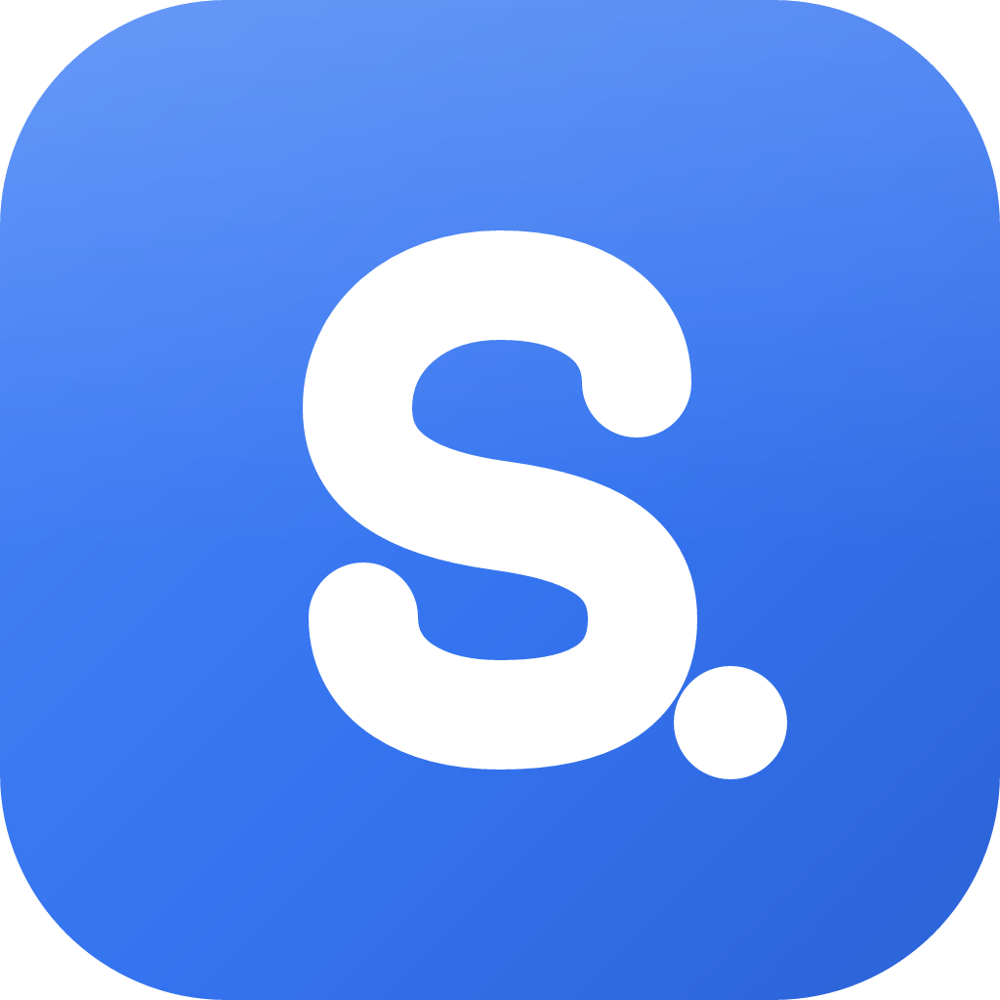
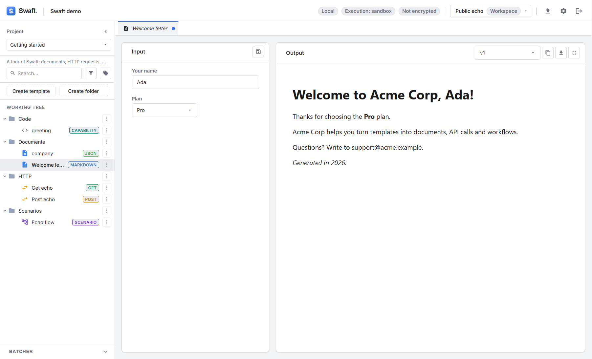

<div align="center">



# Swaft

**A local-first desktop workspace for templates, HTTP requests, code and visual workflows.**

[](https://github.com/BoniFederico/swaftapp/actions/workflows/ci.yml)
[](https://github.com/BoniFederico/swaftapp/releases/latest)
[](LICENSE)
[](https://bonifederico.github.io/swaftapp/)

[Download](#download) · [Documentation](https://bonifederico.github.io/swaftapp/) · [Wiki](https://github.com/BoniFederico/swaftapp/wiki) · [Run from source](#run-from-source) · [Contributing](CONTRIBUTING.md)


</div>

---

Swaft ("Strange Workspace App for Technician") is a desktop app for people who repeat the same
technical tasks: rendering documents from templates, calling APIs, transforming data and chaining
these steps together. You write everything once as a versioned **template** powered by the
[Seebo](https://bonifederico.github.io/swaftapp/seebo/) formula engine. You then run it with
different inputs and environments, by hand or as an automated **scenario**.

Everything stays on your machine. A workspace is either a single `.swaft` file (optionally
password-encrypted), a plain folder, or a Git repository, all in an open, human-readable format.
There is no account, no cloud and no telemetry.

## Features

<table>
<tr>
<td width="50%" valign="top">

**📄 Document templates.** Text, Markdown, HTML, JSON, YAML and more, with `${ formulas }`,
input forms, live preview and versioned releases.

</td>
<td width="50%" valign="top">

**🌐 API requests.** A full HTTP client: params, headers, body, auth, proxies and history. Imports
from and exports to Postman, Bruno, OpenAPI, cURL, HAR and `.http`.

</td>
</tr>
<tr>
<td valign="top">



</td>
<td valign="top">


</td>
</tr>
<tr>
<td valign="top">

**🔀 Scenarios.** A visual canvas chaining API, document and code blocks, with decisions, delays,
breakpoints, input prompts and unattended batch runs.

</td>
<td valign="top">

**🧩 Code & actions.** Sandboxed JavaScript capabilities, plus side-effecting actions that need
explicit confirmation and leave receipts.

</td>
</tr>
<tr>
<td valign="top">


</td>
<td valign="top">


</td>
</tr>
</table>

Also included:

- **environments**
- **secrets** stored in your OS keychain (never in workspace files)
- per-workspace **restrictions** (execution mode, blocked domains, enforced headers)
- a built-in **Git** panel
- a **batcher** for rendering many templates at once

## Download

Get the latest installers from **[GitHub Releases](https://github.com/BoniFederico/swaftapp/releases/latest)**:

| Windows | macOS | Linux |
|---------|-------|-------|
| `Swaft-<version>-setup.exe` | `Swaft-<version>-arm64.dmg` (Apple silicon)<br>`Swaft-<version>-x64.dmg` (Intel) | `Swaft-<version>-x86_64.AppImage`<br>`swaft_<version>_amd64.deb` |

The builds are not code-signed yet. Windows and macOS ask for a one-time confirmation the first
time you open Swaft; the [installation guide](https://bonifederico.github.io/swaftapp/installation/)
walks you through it. Git is optional and only needed for Git-backed workspaces.

**Try it in a minute:** download or clone this repository, open Swaft, choose
**Open → From folder** and select [`examples/demo-workspace`](examples/).

## Run from source

You need **Node.js 20 or newer** (with npm 10+) and Git.

```bash
git clone https://github.com/BoniFederico/swaftapp.git
cd swaftapp
npm ci          # install the exact locked dependencies (downloads Electron, ~100 MB)
npm run dev     # start the app with hot reload
```

The Swaft window opens on the homepage. Other useful commands:

```bash
npm run build && npm start    # run the production build locally
npm run dist                  # build the installer for your OS into apps/desktop/release/
npm run verify                # typecheck + lint + tests (what CI runs)
npm run build && npm run e2e  # end-to-end tests against the built app
```

On Linux, Electron needs a few system libraries. See
[Building from source](https://bonifederico.github.io/swaftapp/building-from-source/) for those, the
test setup, environment variables and the project layout. If something goes wrong, check
[Troubleshooting](https://bonifederico.github.io/swaftapp/troubleshooting/).

## Documentation

The full guide is at **<https://bonifederico.github.io/swaftapp/>** and mirrored on the
[GitHub Wiki](https://github.com/BoniFederico/swaftapp/wiki). Good starting points:

- [Getting started](https://bonifederico.github.io/swaftapp/getting-started/): your first workspace
  and template
- [Core concepts](https://bonifederico.github.io/swaftapp/concepts/): workspaces, templates,
  releases, environments
- [User guide](https://bonifederico.github.io/swaftapp/guide/): every view, task by task
- [Seebo formulas](https://bonifederico.github.io/swaftapp/seebo/): the template language
- [Workspace format](https://bonifederico.github.io/swaftapp/reference/workspace-format/): the
  on-disk format, for scripting and review

## Project layout

```
apps/desktop        Electron app: main process (services, storage, HTTP, Git, Seebo), preload bridge, React UI
packages/shared     typed op contract shared by main and renderer, plus import/export codecs
examples            demo workspace
e2e                 Playwright-for-Electron tests
docs                documentation site (also synced to the wiki)
```

## Contributing

Bug reports, ideas and pull requests are welcome. Please read [CONTRIBUTING.md](CONTRIBUTING.md)
first, and report security issues privately as described in [SECURITY.md](SECURITY.md). Changes
are listed in the [CHANGELOG](CHANGELOG.md).

## License

[MIT](LICENSE) © Federico Boni
