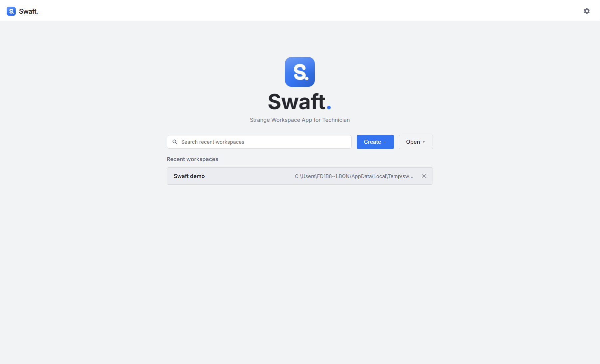
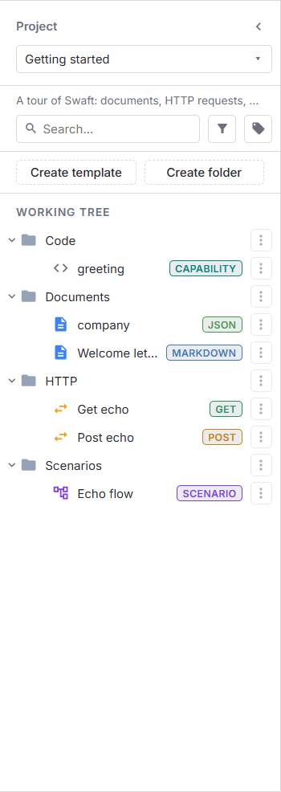

# Getting started
{: .no_toc }

This page takes you from a freshly installed Swaft to a first rendered template.
{: .fs-6 .fw-300 }

<details open markdown="block">
  <summary>Table of contents</summary>
  {: .text-delta }
1. TOC
{:toc}
</details>

---

## Before you begin

- **Install Swaft** — see [Installation](installation.md). To run or package the app from a source
  checkout instead, see [Building from source](building-from-source.md).
- **[Git](https://git-scm.com/)** on your `PATH` is optional. You only need it for **Git folder**
  workspaces; Swaft calls your installed `git` binary directly and reuses your existing SSH keys and
  credential helper.

{: .note }
> There is **no account and no sign-in**. Swaft is local-first: you launch the app and go straight to
> the homepage. The only password you may ever set is the optional one that **encrypts a workspace
> file** (see [Workspaces](guide/workspaces.md#encryption)).

## The homepage

When the app opens you land on the **homepage**. It lists your **Recent workspaces** (with a
**Search recent workspaces** box and a **Remove from recent** button on each entry) and offers two
menus:

| Menu | Entry | What it does |
|------|-------|--------------|
| **Create** | **Local file (.swaft)** | A new workspace stored as a single `.swaft` file. Can be encrypted. |
| | **Local folder** | A new workspace stored as a folder of plain, readable files (no Git). |
| | **Git folder (.git)** | A new workspace stored as plain files in a Git repository. |
| **Open** | **From .swaft** | Open a `.swaft` file. |
| | **From folder** | Open a folder or Git workspace. |
| | **Clone from URL** | Clone a Git repository and open it as a workspace. |

The Git entries are shown only when a `git` binary is available. See
[Workspaces](guide/workspaces.md) for how the three storage forms compare.



## Try the demo workspace

The quickest way to see every feature is the demo workspace that ships in the repository:

1. Download [`examples/demo-workspace`](https://github.com/BoniFederico/swaftapp/tree/main/examples)
   (clone the repository, or *Code → Download ZIP* on GitHub and extract it).
2. On the homepage choose **Open → From folder** and select the `demo-workspace` folder.
3. In the Working Tree, open the **Project** selector and pick **Getting started**.
4. In the header, choose the **Public echo** environment. The demo's HTTP requests and its scenario
   call <https://httpbin.org>, so they need it and an internet connection.



Then open **Welcome letter** (a Markdown document with inputs), **Get echo** (an API request),
**greeting** (a JavaScript capability) and **Echo flow** (a scenario that chains them). Click **Run**
on the scenario to watch it execute.

## Your first workspace

1. Open **Create** and choose **Local file (.swaft)**.
2. In the **Create workspace** dialog, enter a **Workspace name**, then click **Choose…** to pick
   where the file is saved (for example `demo.swaft`).
3. *(Optional)* Turn on **Encrypt this workspace** and enter a password (at least 8 characters).

   {: .warning }
   > If you encrypt a workspace and lose the password, the data is **unrecoverable** — there is no
   > backdoor and no reset.

4. Leave **Execution mode** on **Sandbox (recommended)** and click **Create**.

The workspace opens into the **workspace shell**: the **Working Tree** on the left, a tabbed view
area on the right, and a top bar with the environment picker, the **Import / Export** menu,
**Settings** and — for Git workspaces — the Git status button.

Prefer files you can read, diff and version? Choose **Local folder** or **Git folder (.git)** instead
and pick a folder. The storage form is fixed once the workspace is created.

## Your first template

1. In the Working Tree, open the **Project** selector and choose **Create project**. Give it a name
   (and optionally a description). Projects filter the tree; everything lives inside one.
2. Click **Create template**, choose the **Document** type, give it a name and click **Create**.
3. Open the template. It starts with one input already declared. Its source is:

   ```text
   Hello ${ textbox({ id: 'name', label: 'Your name', type: string() }) }!
   ```

   That `${ … }` is a **Seebo formula**. `textbox({ … })` declares an input; the **Input** panel
   renders a text box for it.
4. Type a value into the **Your name** field. The **Output** updates to `Hello <name>!`.

That is the core loop: **a template declares inputs with formulas, you fill the Input panel, Swaft
renders the output.** From here you can:

- Change the document **subtype** (Markdown, HTML, Mermaid, ECharts, JSON, YAML, e-mail…) in the
  template editor to change how the output is rendered — see
  [Document templates](guide/document-templates.md).
- Build an **[API request](guide/api-requests.md)** whose URL, headers and body contain the same
  `${ … }` formulas.
- Add **[environments](guide/environments.md)** so `${ BASE_URL }` resolves from a variable set you
  can switch in one click.
- Cut a **[release](guide/batcher-and-releases.md#releases)** to freeze a version of the template.

## Where to go next

- **[Core concepts](concepts.md)** — the vocabulary (workspace, Working Tree, template types,
  releases, environments) in one page.
- **[User guide](guide/index.md)** — step-by-step for every feature.
- **[Keyboard shortcuts](guide/keyboard-shortcuts.md)** — save, search, undo and more.
- **[Seebo formulas](seebo/index.md)** — everything you can write inside `${ … }`.
