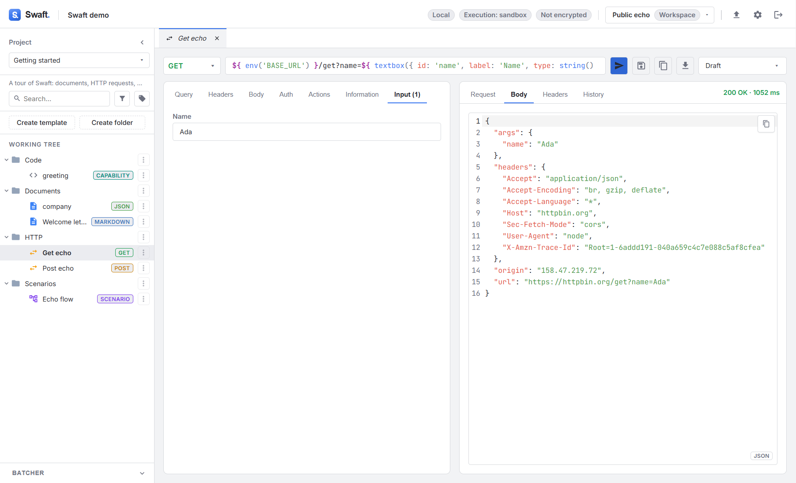

# API requests
{: .no_toc }

<details open markdown="block">
  <summary>Table of contents</summary>
  {: .text-delta }
1. TOC
{:toc}
</details>

---

An **API template** is a structured HTTP request. Swaft has a real HTTP client that runs in the
backend — requests are a proper request model, never cURL strings, and every field can contain
[Seebo formulas](../seebo/index.md).

## The API view

```
┌──────────────────────────────────────────────────────────────────────────────┐
│ GET ▾  https://${ BASE_URL }/users/${ id }   Send · Save · cURL ⇄ · Version ▾  │
├───────────────────────────────────┬──────────────────────────────────────────┤
│ Query · Headers · Body · Auth ·   │ Response: status · time                  │
│ Actions · Information · Input     │ Request · Body · Headers · History       │
└───────────────────────────────────┴──────────────────────────────────────────┘
```

The top row holds:

| Control | Purpose |
|---------|---------|
| **Method** | One of `GET`, `POST`, `PUT`, `PATCH`, `DELETE`, `HEAD`, `OPTIONS`. (The method is its own field; an API template's subtype is always `json`.) |
| **URL** | The request URL. Formulas are highlighted and previewed. |
| **Send** | Run the request through the backend and show the response. |
| **Save** | Save the request (also **Ctrl+S** / **Cmd+S**). |
| **Copy as cURL** | Copy the request to the clipboard as a cURL command. |
| **Replace from cURL (clipboard)** | Overwrite the request with a cURL command from the clipboard. |
| **Version** | Work on the **Draft** or a specific [release](batcher-and-releases.md#releases). |

The request tabs:

| Tab | Contents |
|-----|----------|
| **Query** | Query parameters (key/value table, or **Bulk edit** as text). |
| **Headers** | Request headers. |
| **Body** | **Body type** — **No body**, `json`, **Form URL encoded**, `text` or `xml` — and the body editor. |
| **Auth** | Credentials (below). |
| **Actions** | Pre/post automations (below). The tab shows how many are attached. |
| **Information** | Markdown documentation for the request (double-click to edit). |
| **Input** | Inputs declared by formulas in the request. Shown only while something still needs a value or a formula has an error. |



## Formulas in requests

Any field — URL, params, headers, body — can use `${ … }`. Formulas are rendered **server-side just
before the request is sent**, so you can:

- pull environment variables: `https://${ BASE_URL }/v1/orders`
- build a body from inputs or upstream data:

  ```json
  { "customer": "${ env('CUSTOMER_ID') }", "region": "${ REGION }" }
  ```

The **Input** tab exposes any widget inputs the request declares, exactly like a document's Input
panel, so a request can prompt for values before it runs.

{: .important }
> Never paste a token directly into a field. Store it under **Settings → Secrets** and reference it
> with `${ secret('API_TOKEN') }` — see [Secrets](security-and-settings.md#secrets).

## Authentication

The **Auth** tab supports:

| Type | Sends |
|------|-------|
| **None** | No auth. |
| **Inherit** | Whatever the nearest [folder](#inheriting-from-folders) up the chain defines (previewed in the tab). |
| **Basic** | `Authorization: Basic <base64(user:pass)>` from **Username** and **Password**. |
| **Bearer** | `Authorization: Bearer <token>` from **Token**. |
| **API key** | A key sent in a **Header** or **Query param** you name (**Send in**). |

{: .important }
> Enter credentials as **secrets**, not as plain text: put `${ secret('NAME') }` in the token,
> username, password or key field. The secret's value lives in the OS keychain and is resolved only
> when the request is sent — it is never written to the workspace and never shown back in the UI. See
> [Security & settings](security-and-settings.md#secrets).

Requests created by older versions may still point at a keychain entry the old way; the Auth tab then
offers **Migrate to secret(...)** (or **Remove unused reference** when it can't be migrated).

## Sending & the response

Pressing **Send** routes the call through the backend HTTP client. The response area shows the
**Status** and **Time**, and these tabs:

- **Request** — the request exactly as it was sent, with formulas rendered;
- **Body** — the response body, highlighted;
- **Headers** — the response headers;
- **History** — past calls (shown once there are any);
- **Pre-Action** / **Post-Action** — the outcome of attached actions (shown when they ran).

Outbound requests are subject to the workspace's **blocked-domain list** and any **enforced
headers** — see [Restrictions](security-and-settings.md#restrictions).

## History

Each API template keeps its own **call history** (local to your device). History is
**metadata-only** — method, URL, status, timing — and **never** stores request or response bodies.
Use **Clear history** to remove it, or **Export HAR** to save it as a HAR file.

## Inheriting from folders

A folder that contains API templates acts as an **HTTP collection**. It can define shared policy
that requests inside it **inherit**:

- common **headers**,
- a **proxy**,
- default **authentication**,
- **pre/post actions**.

Folder headers, proxy and actions apply to every request inside the folder automatically (a
request's own header with the same name wins). For authentication, set the request's Auth type to
**Inherit**. Folders nest, so the policy propagates down the chain — configure a common header, an
auth scheme or a proxy once per collection instead of per request. Inherited actions are listed
under **Inherited from folders** in the request's **Actions** tab. Edit the policy from the
[folder's detail view](working-tree.md#folders).

## Request actions (automation)

The **Actions** tab attaches [actions](code-and-actions.md#action-templates) that run around the call:

- **Before the request** (pre) actions receive the request and may return
  `{ patch: { headers, query, url, body } }` to change it — for example to add a fresh token. If a
  pre action fails, nothing is sent.
- **After the response** (post) actions receive the request and the response (with the JSON body
  parsed) — for example to extract a value and store it in an [environment](environments.md)
  variable for the next request. Failures are reported; the response is still shown.

Use **Attach an action** to add one; each can be **Enabled** or disabled and given input values.

Attached actions run every time you press **Send** — attaching one is your explicit opt-in, so they
do not ask for a per-call confirmation. Their outcomes, including any environment variables they
wrote, appear in the **Pre-Action** / **Post-Action** response tabs. This is also how API blocks pass
data along inside a [scenario](scenarios.md).

## Security notes

- Every call executes in the **backend**, never directly from the UI.
- The blocked-domain check is re-evaluated on **each redirect** (max 5), which blunts SSRF-style
  redirect tricks.
- In production builds, a folder proxy routes the request through Electron's proxied session.
