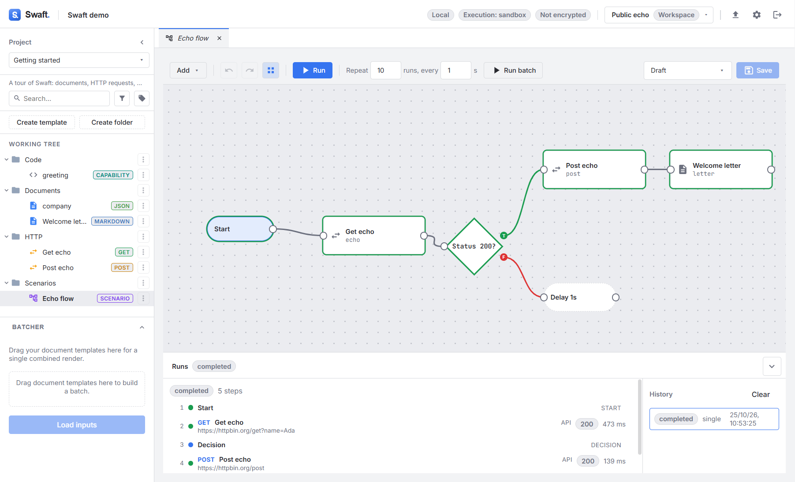
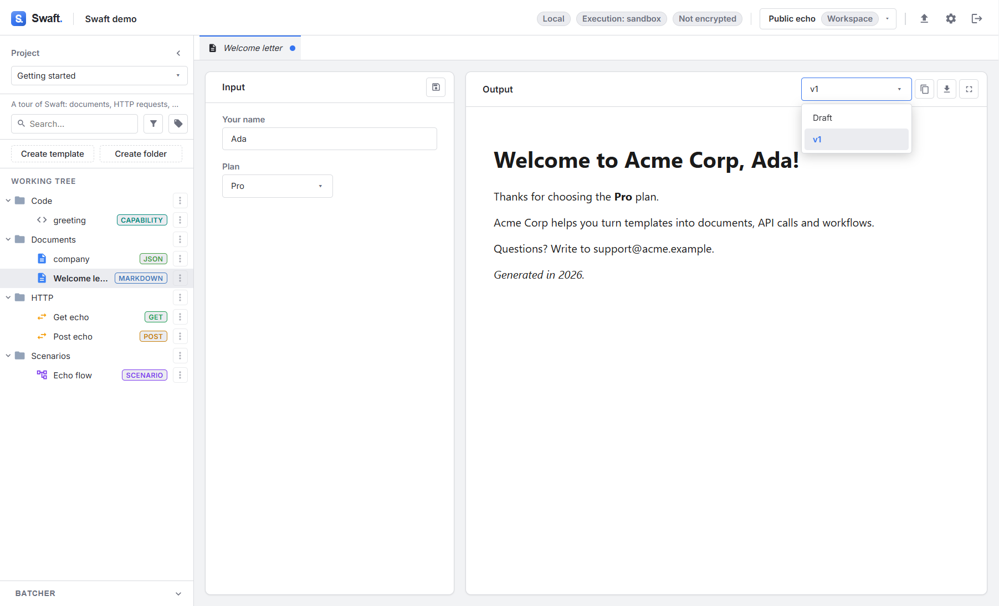

# Batcher & releases
{: .no_toc }

Two ways to work with more than one version or document at a time.
{: .fs-6 .fw-300 }

  
Table of contents

  {: .text-delta }
1. TOC
{:toc}

---

## The Batcher

The **Batcher** renders several **document templates together** into one combined output. It is a
collapsible panel under the Working Tree.

1. **Drag document templates** from the tree into the panel, in the order you want them combined.
   Order is significant. **Remove from batch** drops one; **Clear batch** empties the panel.
2. Click **Load inputs**. The view area opens **Batch inputs (*N* templates)** with the inputs of
   every template in the batch.
3. Fill them in and click **Render batch** to produce the combined output.

How inputs and composition work:

- **Shared inputs are resolved once.** If several documents declare an input with the same `id`, you
  fill it a single time and the value is reused across all of them.
- **Merge macros apply.** Templates can pull each other in with Seebo's
  [`ABSORB` / `MERGE`](../seebo/actions-macros.md#composition-macros) aggregator macros, so the batch
  can assemble a single composite document.
- Only **document** templates are accepted — API, code and scenario templates cannot be batched.

The Batcher is a **transient composition tool**: it is not itself a saved, versioned object.

{: .note }
> The Batcher can be turned **off** for a workspace in
> [Settings → Restrictions](security-and-settings.md#restrictions), which hides the panel.

## Releases

A **release** is a named, saved version of a single template, with a **changelog**. Releases let you
keep a stable version around while you continue editing.

### The draft and releases

Every template has an editable **Draft**. In the [template editor](working-tree.md#the-template-editor):

- **New release** — snapshot the current content under a name (for example `v1.2`).
- **Save** — saves whichever version is selected in the **Release** picker. Releases are **editable
  in place**, so you can correct a saved version without cutting a new one.
- **Delete** — use the × next to a release in the picker (**Delete release**). You can even delete
  the Draft (**Delete draft**), leaving only releases.
- **Changelog** — shows the template's history of changes; the changelog is common to all template
  types.

### Selecting which version you use

The **Version** picker in each view — document, API request and scenario — selects which version
the template renders or executes as. The selection is:

- **per template**, and
- **personal and local to your device** — it never changes what anyone else sees in a shared
  workspace.

If you haven't chosen one, Swaft falls back to the **latest release**, or the **Draft** when there
are no releases.

{: .tip }
> Because release selection is per-device, two people can pin **different** releases of the same
> shared template — useful when one is validating a new version while another keeps using the stable
> one.
