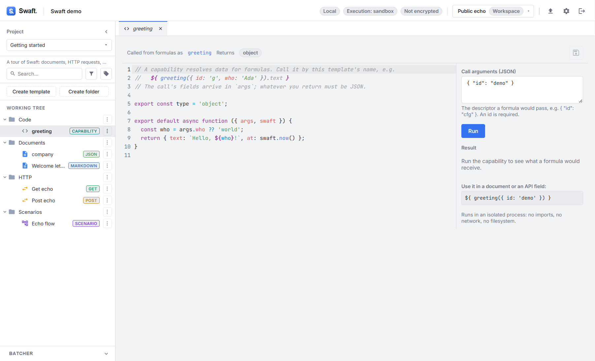

# Code & actions
{: .no_toc }

<details open markdown="block">
  <summary>Table of contents</summary>
  {: .text-delta }
1. TOC
{:toc}
</details>

---

Swaft lets you extend your templates with **your own JavaScript**, in two flavours:

- **Capability templates** — return **data** for use inside formulas (must be pure).
- **Action templates** — perform a confirmed **side effect** and produce a receipt.

Both run as **sandboxed code**, isolated from the rest of the app.

## Where code runs (the sandbox)

Capability and action code executes in an **isolated Electron utility process**, separate from both
the UI and the main backend. In this sandbox:

- there is **no ambient file-system or network access**;
- the return value must be **JSON-serializable**;
- each call is bounded by a **timeout** (2 seconds by default);
- only the **sandbox** security profile is available in the current build. (A more permissive
  "developer" profile that would grant module and HTTP access is designed but **not yet
  implemented** — the sandbox deliberately refuses to be lenient until it is.)

Your code receives a small, safe `swaft` helper object (e.g. `swaft.env.get`, `swaft.env.set`,
`swaft.now`, `swaft.log`) rather than raw Node APIs.

## Capability templates

A **capability** returns data that a formula can use. It is called from a formula **by the
template's own name**. The starter capability shows the whole contract:

```js
// This capability is called from a formula by this template's name, e.g.
//   ${ myCapability({ id: 'cfg' }).baseUrl }
// The call's own fields arrive in `args` (`id` included); whatever you return must be JSON.

/** Seebo type of the resolved value: object (default), string, int, float, bool, array, … */
export const type = 'object';

export default async function ({ args, swaft }) {
  return {
    baseUrl: swaft.env.get('BASE_URL') ?? 'https://api.example.com',
    calledWith: args.id,
    at: swaft.now(),
  };
}
```

- `export const type` declares the Seebo type of the value you return, so formulas type-check
  against it.
- `args` is the object passed at the call site (`{ id: 'cfg' }` above).
- The default export returns the value (here an object you can index in a formula).

Use it from any document or request formula:

```text
Base URL is ${ myCapability({ id: 'cfg' }).baseUrl }
```

Capabilities must be **pure** — same inputs, same output, no side effects. If you need to *do*
something, use an action.

## The Code view

Opening a capability or action shows the **Code view**: the source editor on one side and a
test-run panel on the other.

| Control | Capability | Action |
|---------|-----------|--------|
| Registration | **Called from formulas as** `<name>`, plus the **Returns** type. | **Used in a plan as type** `<name>`. |
| Test input | **Call arguments (JSON)** — the descriptor a formula would pass, e.g. `{ "id": "cfg" }` (an `id` is required). | **Input (JSON)** — what the caller passes as `input`. |
| Run | **Run** shows the **Result** and how long it took. | **Run** or **Dry run**; shows the result and the **Environment variables written**. |
| Output | **Log** — anything written with `swaft.log`. | **Log**. |

**Save** (or **Ctrl+S** / **Cmd+S**) stores the code. If a capability is not registered — the name
is not a valid identifier, clashes with a built-in capability, or is already used by another
capability — the view tells you why.



## Action templates

An **action** is the only thing in Swaft that changes the outside world, so it is governed by
confirmation and receipts. The starter action:

```js
// An action is an effect. Declare it in a document with
//   ${ action({ id: 'save', type: 'myAction', input: { … }, confirm: true }) }
// or attach it to an API request as a pre/post trigger. It never runs without confirmation.

export default async function ({ input, api, swaft }) {
  swaft.log('running with', input);

  // Environment writes are applied only if this action succeeds.
  // swaft.env.set('TOKEN', api?.response?.json?.token);

  return { ok: true, seen: Object.keys(input ?? {}) }; // becomes the receipt
}
```

- `input` is the `input` object from the `action({ … })` declaration.
- `api` is present when the action runs as an API [pre/post trigger](api-requests.md#request-actions-automation)
  — it exposes the request and response.
- `swaft.env.set(...)` writes an [environment](environments.md) variable, but the write is **committed
  only if the action succeeds**.
- The returned object becomes the action's **receipt**.

### Declaring an action

You *declare* an action where you want it to happen — inside a document formula, or as a request
pre/post trigger:

```text
#{ type is the action template's name; input values can come from inputs or data }
${ action({
  id: 'save',
  type: 'myAction',
  input: { orderId: textbox({ id: 'orderId', label: 'Order id' }) },
  confirm: true,
  environment: 'test'
}) }
```

Inside a formula you write plain expressions — never a nested `${ … }`. Here the `textbox(...)` call
declares an **Order id** input and its value becomes `input.orderId`. Comments go in a separate
`#{ … }` slot; there is no comment syntax inside a formula.

An `action({ … })` formula renders to the empty string — an effect is not text. When a render
declares actions, the [Action panel](document-templates.md#the-document-view) appears.

### Confirmation, execution & receipts

- **Nothing runs automatically.** Each action declared in a document must be **explicitly
  confirmed** (**Confirm action** *id*) in the **Actions** panel before it executes. **Perform
  actions** runs the confirmed actions in order, **fail-fast** (it stops at the first error).
- The **backend re-renders the template itself** to derive the authoritative action plan — it never
  trusts a plan sent from the UI.
- Every execution yields a **receipt**: a local-only record of the outcome (status, environment,
  external id, error). Receipts are **redacted** — input values and secrets never appear in them.

### Environments & the sandbox

Actions target an **environment** (`test`, `preprod`, `prod`, …; `test` when none is given). The
**Sandbox** execution mode (the default) **forbids `prod`**. Switching the workspace to **Developer**
execution mode under **Settings → Restrictions** is what unlocks `prod`-targeted actions.

## Trusting imported code

Because a shared workspace can travel between machines, code that **arrived inside a workspace you
opened** (authored somewhere else) is treated as **untrusted** and stays **inert** until you review
and approve it. Swaft shows a banner listing the affected capabilities with a **Review** button;
read the code, then choose **Approve and run**. Your approval is stored in the app's local store on
this device — **never** inside the workspace — so approving code on your machine never silently
approves it on someone else's. Editing the code revokes the approval.
