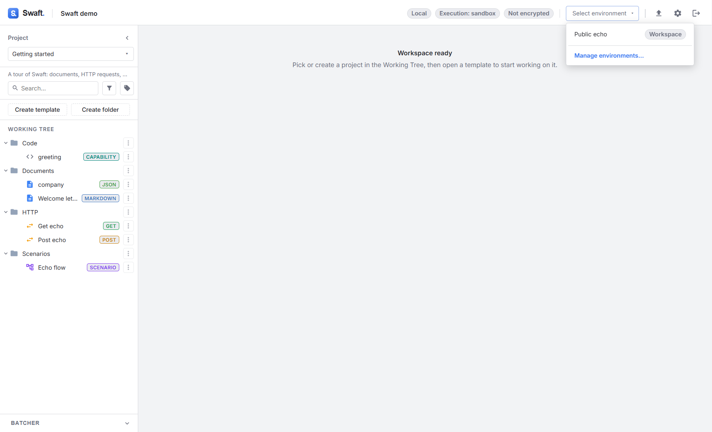

# Environments
{: .no_toc }

<details open markdown="block">
  <summary>Table of contents</summary>
  {: .text-delta }
1. TOC
{:toc}
</details>

---

An **environment** is a named set of variables — plain string values like `BASE_URL`, `REGION` or
`ACCOUNT_ID`. You keep several environments (say **Dev**, **Staging**, **Prod**) and switch the
**active** one in a click; every formula that reads a variable follows along.

{: .important }
> Environment variables are for **non-secret** configuration. Do **not** put passwords or API tokens
> in them — those belong in [secrets](security-and-settings.md#secrets), which are stored in the OS
> keychain and read with `${ secret('NAME') }`. Environment values are stored as plain text in the
> workspace.

## Personal vs. Workspace

Each environment has an owner, shown as a badge next to its name:

| Badge | Meaning |
|-------|---------|
| **Workspace** | Shared: everyone using the workspace sees it. |
| **Personal** | Owned by you. |

Environments you create in **Settings → Environments** are **Workspace** environments. Think twice
before [exporting](working-tree.md#bundling-environments) a Personal one to someone else.

## Managing environments

Open **Settings → Environments** (or **Manage environments…** at the bottom of the environment
picker). There you can create an environment (**New environment**), give it a **Name** and
**Description**, add **Variables** as key/value rows (**Add variable**), **Save** it, or **Delete**
it.

The **active environment** is chosen from the **Active environment** picker in the top bar (or
**No environment**). Switching it re-renders every open document and re-resolves every `env(...)`
reference across the app. The active selection is **local to your device**, so switching
environments never changes anything for other users of a shared workspace.



## Config vs. secret label

Each variable can be marked **config** (the default) or **secret** with the lock-icon toggle next to
its row (**Mark as secret** / **Mark as config**). A secret-labeled value is masked (shown as a password field) in the editor.

{: .warning }
> The label is **advisory only** — it does not encrypt the value or change how `env(...)` resolves it.
> The variable is still stored as plain text in the workspace, exactly like a config one. Use the
> label to flag values that shouldn't be casually shared, not as a substitute for a real
> [secret](security-and-settings.md#secrets).

The label gates two things:

- **[Export](working-tree.md#import--export)** — a secret-labeled variable is never included in a
  Postman/Bruno environment bundle; only its name appears, in a comment, so a teammate you share the
  export with knows something was left out.
- **The pre-commit check** on a Git workspace — see
  [Using Git version control](workspaces.md#pre-commit-secret-check) — treats a labeled variable as an
  acknowledged risk and does not re-flag it.

Each environment's JSON file also gets a companion, hand-editable `.env` (dotenv) file alongside it —
useful if you want to peek at or copy config values with a plain text editor or a tool that reads
`.env` files. It is regenerated every save from the JSON (the real source of truth) and never
contains secret-labeled values.

## Reading variables in formulas

Read a variable with the **`env(...)`** data capability:

```text
${ env('BASE_URL') }/v1/orders
```

There is also a **shorthand**: a bare `${ NAME }` that Seebo doesn't otherwise recognize is
resolved as `env('NAME')`:

```text
${ BASE_URL }/v1/orders    #{ same as env('BASE_URL') }
```

The shorthand applies only when the slot contains **nothing but the name**. Inside a larger
expression, write `env('NAME')` explicitly — `${ env('BASE_URL') + '/v1' }`.

`env(...)` resolves during rendering and never appears in the [Input panel](document-templates.md) —
it is data, not a prompt. This works everywhere formulas do: documents, API request URLs/headers/
bodies, decision conditions, and so on.

## Writing variables from actions

[Action templates](code-and-actions.md#action-templates) can **write** environment variables with
`swaft.env.set(...)`. This is the idiomatic way to carry a value from one step to the next — for
example, a login request's **post action** stores a token that later requests read with
`${ env('TOKEN') }`:

```js
export default async function ({ api, swaft }) {
  swaft.env.set('TOKEN', api?.response?.json?.token);
  return { ok: true };
}
```

The write is committed **only if the action succeeds**, and — like all actions — it runs under
[confirmation](code-and-actions.md#confirmation-execution--receipts).
