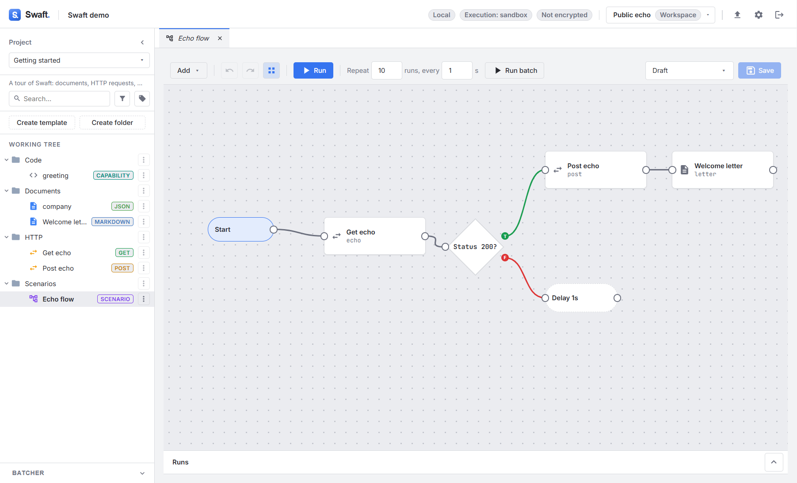
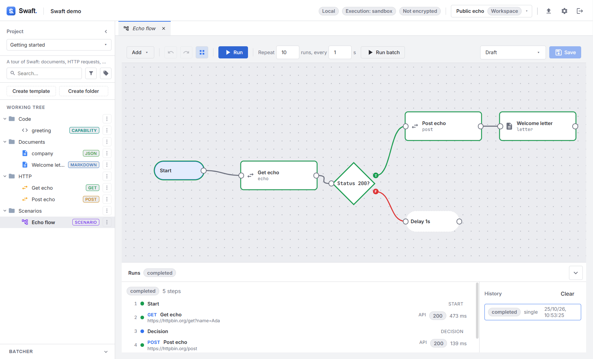

# Scenarios
{: .no_toc }

<details open markdown="block">
  <summary>Table of contents</summary>
  {: .text-delta }
1. TOC
{:toc}
</details>

---

A **scenario** is a visual workflow. On a canvas you place **blocks** — API requests, actions and
capabilities — and **control nodes**, connect them with edges, and run the whole thing. Data flows
forward: each block can read the output of blocks that ran before it.

## The canvas

Open a scenario template to get the canvas. Pan by dragging the background, zoom with the mouse
wheel, and drag nodes around. **Snap** toggles snapping to the grid so edges stay tidy.

Add nodes two ways:

- **Drag a template** from the [Working Tree](working-tree.md) onto the canvas — it becomes a
  **block** referencing that template (API, action, capability or document; scenarios cannot be
  nested).
- Use the **Add** menu to insert a control node: **Add start**, **Add decision** or **Add delay**.

Connect nodes by dragging from a node's **output port** (right side) to another node. Click a node or
connection to select it; the **Node inspector** (side panel) then edits it: a block's **Alias**, a
start's alias, a decision's **Condition** or a delay's **Delay (seconds)**. A selected connection can
be removed with **Delete connection**.

The toolbar also has **Undo** / **Redo**, the **Run** and batch controls (below), a **Version**
picker for the scenario itself, and **Save**. See [Keyboard shortcuts](keyboard-shortcuts.md) for
the canvas keys.

### Block menu

Right-click a block for:

| Entry | Effect |
|-------|--------|
| **Edit** | Open the block's template in the template editor. |
| **Run this block** | Run only this block. |
| **Run from here** | Start a run at this block and continue along the graph. |
| **Set breakpoint** / **Remove breakpoint** | Pause runs right before this block (see [Breakpoints](#breakpoints)). |
| **Delete** | Remove the block and its connections, after confirmation. |

**Run this block** and **Run from here** are also available as buttons in the Node inspector.



## Node kinds

| Kind | Purpose | Ports |
|------|---------|-------|
| **Start** | Entry point of the run. | One output, no input. |
| **Block** | Runs an **API**, **action**, **capability** or **document** template. | One input, one output. |
| **Decision** | Branches on a boolean [Seebo formula](../seebo/index.md). | One input; **two** outputs: `true` and `false`. |
| **Delay** | Waits a fixed number of seconds. | One input, one output. |

The graph is a **single active path**: every node except a decision has at most **one** outgoing
edge, a decision has exactly one edge per branch, and nothing connects into a start node. Deleting a
node also removes the edges touching it.

## Passing data with `previous(...)`

When a block runs, later blocks can read its output through the **`previous(...)`** data capability:

- **`previous()`** — the immediate predecessor's output.
- **`previous('alias')`** — a specific upstream block, by the **alias** you gave it in the inspector.

Every executed block is normalized to the same **output envelope**, so formulas read predictably:

```text
${ previous('login').json.token }   #{ a field from an API block's JSON response }
${ previous('lookup').output }      #{ a capability block's returned value }
${ previous('save').ok }            #{ whether an action block succeeded }
```

The envelope includes `ok`, `output`, and — for API blocks — `status`, `json`, `headers`, `method`,
`url`, `durationMs` (metadata only, never used to persist bodies). For a **document** block whose
subtype is `json`, `output` is parsed into an object, so `${ previous('payload').output.id }` works;
invalid JSON fails the formula.

{: .note }
> `previous(...)` only carries data **during a scenario run**. If you open a template standalone
> that uses it, `previous(...)` resolves to nothing — the template stays renderable.

## Decisions

A **decision** node holds a boolean formula and follows its `true` or `false` edge accordingly:

```text
${ previous('login').status == 200 }
```

Edit the condition in the Node inspector with the same formula field used everywhere else.

## Running a scenario

Press **Run** to start. If the scenario has several start nodes, **Run** opens a menu so you can pick
one (unnamed starts are listed as **Start 1**, **Start 2**, …). A run:

1. begins at the chosen **start node** (or the block you chose with **Run from here**),
2. executes each block, recording a step,
3. evaluates decisions to pick a branch,
4. honours **delay** nodes,
5. stops at the end of the path, on error, or when you press **Stop**.

**Stop** is cooperative: it halts the run **between steps** (a step already in flight finishes
first). Node colours on the canvas show each block's outcome as the run progresses.

The **Runs** panel at the bottom shows live progress, each step's detail, and the run **History**
(**Clear** removes it). Use **Minimize** / **Maximize** to fold the panel away.



### Batch runs

To run the scenario repeatedly and unattended, use the batch controls in the toolbar: **Repeat**
*N* **runs, every** *S* **s**, then **Run batch** (again with a start-node menu when there are
several). *N* is between 1 and 1000; *S* is the pause between runs in seconds (0 or more, in steps of
0.5). While a batch runs, the toolbar shows **Batch: done / total runs** and a **Stop batch** button.

| Mode | Behaviour |
|------|-----------|
| **Run** (attended) | If a block needs an input that isn't bound, the run **pauses** (**This block needs inputs to continue**) and asks you for it; **Continue** resumes. |
| **Run batch** (unattended) | A missing input **fails that step** instead of prompting. |

### Breakpoints

Right-click a block and choose **Set breakpoint** to make a run **pause right before that block
executes**, whichever start node it was launched from. A marker on the block shows the breakpoint;
**Remove breakpoint** clears it. While paused, the Runs panel shows **Paused at a breakpoint**, every
step recorded so far, and a **Resume** button. The run's state is held in memory, so resuming
continues exactly where it left off — but only while the app stays open; a breakpoint pause does not
survive an app restart.

### Reusing an input across a run

When an attended run pauses for a missing input (an **API** or **document** block), each field in
the input panel has a **Reuse this value for other inputs with the same id in this run** toggle.
Values it checks are remembered for the rest of that run: any later block — api or document — that
asks for an input with the same id is filled automatically instead of pausing again.

### Authorizing actions

A scenario may run several **actions** without stopping to confirm each one. Instead, when a
scenario contains action blocks, Swaft asks once (**Authorize actions** → **Authorize and run**) and
that acknowledgement authorizes its action blocks for the run. The **sandbox still applies** —
`prod`-targeted actions remain forbidden unless the workspace is in **Developer**
[execution mode](security-and-settings.md#code-sandbox--execution-mode).

## Run history

Every run is recorded on the **scenario** (not on the individual templates), in local-only history:

- a **run** record (status: running / awaiting-input / completed / failed / cancelled, timing, step
  count),
- one **step** record per executed node — redacted metadata plus a **truncated** output snapshot.
  Consistent with the rest of Swaft, **request/response bodies and action inputs are never
  stored**.

Select a past run in **History** to inspect its steps.
