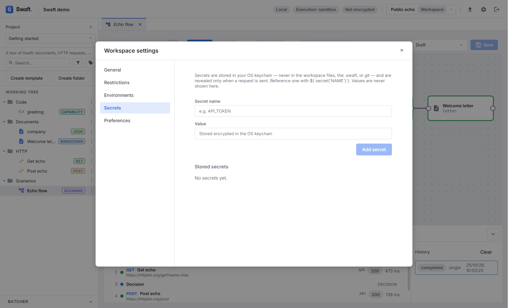

# Security & settings
{: .no_toc }

<details open markdown="block">
  <summary>Table of contents</summary>
  {: .text-delta }
1. TOC
{:toc}
</details>

---

Swaft is built so that the parts that touch the outside world — the network, the file system,
secrets, code execution — are governed by the **backend**, not the UI. This page covers the
security model and the **Settings** that tune it.

## The trust boundary

Swaft is an Electron app with two processes:

- the **renderer** (the UI you see), and
- the **main process** (the backend authority).

The renderer can only ask the backend to do things through a **validated, allow-listed channel** —
there is no local web server and no direct system access from the UI. Every rule below is enforced
in the backend, so the UI cannot bypass it.

## Secrets

API tokens, passwords and keys are **secrets**. Swaft stores them in your operating system's secure
storage (via Electron `safeStorage`: the Keychain on macOS, DPAPI on Windows, the system keyring on
Linux) in the app's own data directory on this device. A secret's value is:

- **never** written into a workspace — not the `.swaft` file, a folder workspace or a Git repository;
- **never** returned to the UI in clear — the Secrets screen only lists names;
- **never** shown in action [receipts](code-and-actions.md#confirmation-execution--receipts), API
  history or diagnostics.

### Managing secrets

Open **Settings → Secrets**:

1. Enter a **Secret name** (for example `API_TOKEN`, up to 64 characters) and its **Value**.
2. Click **Add secret**. Entering the name of an existing secret changes the button to **Update
   value** and replaces its value.
3. **Stored secrets** lists every saved name together with the formula that references it. Use
   **Delete** to remove one.

Values are never displayed again after saving — to change one, enter a new value.

Secrets belong to your device, not to a workspace: every workspace you open on this machine can
reference them, and a colleague who opens a shared workspace must add the same names on their own
machine.



### Using a secret

Reference a secret by name with the `secret(...)` data capability anywhere formulas work — typically
the token, username, password or key field of an [API request's Auth tab](api-requests.md#authentication),
or a header:

```text
${ secret('API_TOKEN') }
```

The value is resolved in the backend only when the request is sent. A name that isn't stored
resolves to an empty string.

{: .warning }
> **Linux without a keyring.** If no OS keyring is available (common on Linux without GNOME Keyring
> or KWallet), **Settings → Secrets** shows a warning: secrets saved there are only **obfuscated**,
> not securely encrypted. Install and unlock a keyring for real protection. On a system with no
> secure storage at all, secrets cannot be saved.

If a request still shows a banner about a legacy keychain reference, the Auth tab offers a one-click
**Migrate to secret(...)** action that rewrites it to the formula form (or **Remove unused
reference**, if the field already has a value).

## Workspace encryption

A **Local file (.swaft)** workspace can be encrypted as a whole file when you create it. Swaft
derives a key from your password with **Argon2id** and encrypts with **AES-256-GCM**. You are
prompted for the password each time you open it. See [Workspaces → Encryption](workspaces.md#encryption).

{: .warning }
> Encryption is **unrecoverable by design** — there is no backdoor or reset. Lose the password and
> the data is gone. (Folder and Git workspaces are not encrypted by Swaft; use file-system or
> repository access controls.)

## Code sandbox & execution mode

[Capability and action code](code-and-actions.md) runs in an **isolated sandbox** with no ambient file
or network access, JSON-only results, and a per-call timeout. Only the **sandbox** profile exists in
the current build.

The workspace has an **execution mode**, chosen when you create it and changeable under
**Settings → Restrictions → Execution mode**:

| Mode | Effect |
|------|--------|
| **Sandbox** (default) | Actions targeting the `prod` environment are **forbidden**. |
| **Developer** | Unlocks `prod`-targeted actions. Switching to it is **guarded**: you must tick **I understand — enable developer mode**. |

Code that **arrived inside a workspace you opened** (authored elsewhere) is **untrusted** until you
approve it on this device — see [Trusting imported code](code-and-actions.md#trusting-imported-code).

## Settings

**Settings** (the gear in the top bar) has five sections:

| Section | Contents | Scope |
|---------|----------|-------|
| **General** | The **Workspace name** and **Icon**. | Workspace |
| **Restrictions** | Execution mode, Batcher, blocked domains, proxy, enforced headers (below). | Workspace |
| **Environments** | [Environment variables](environments.md). | Workspace |
| **Secrets** | [Secrets](#secrets) stored in the OS keychain. | This device |
| **Preferences** | Appearance and behaviour (below). | This device |

### Restrictions

**Settings → Restrictions** holds the workspace-wide controls. Outgoing HTTP rules are enforced by the
backend HTTP client:

| Setting | Effect |
|---------|--------|
| **Execution mode** | **Sandbox** or **Developer** — see [above](#code-sandbox--execution-mode). |
| **Batcher** | **Enabled** / **Disabled** — shows or hides the [Batcher](batcher-and-releases.md#the-batcher) panel. |
| **Blocked HTTP domains** | Outgoing requests to these hosts (and their subdomains) are refused. Empty = no restriction. Re-checked on every redirect. |
| **Enforced proxy URL** | Route **every** outgoing request through this proxy (empty = direct). |
| **Enforced HTTP headers** | Headers applied to every outgoing request, overriding the request's own. |

Click **Save** to apply. Individual [folders](working-tree.md#folders) can additionally propagate
their own headers, proxy and auth to the requests they contain.

### Preferences

**Settings → Preferences** holds your **personal** choices. They are stored on this device only and
are never written into a workspace:

| Preference | Options |
|------------|---------|
| **Theme** | **System**, **Light** or **Dark**. |
| **Primary color** | Blue, Indigo, Teal, Green or Amber. |
| **Font** | Inter, System or Mono. |
| **Language** | English or Italiano. |
| **Working Tree double-click** | **Open the editor** (default) or **Pin the tab (classic)** — see [Tabs](working-tree.md#tabs). |

Changes preview live; click **Save** to keep them or **Cancel** to go back.

## What Swaft does *not* do (yet)

For an accurate mental model, note the current build:

- has **no user account / sign-in** — it is local-first;
- has **no peer-to-peer or server sync** (share via a file or Git instead);
- has **no built-in database client**;
- implements only the **sandbox** code profile (no file/network access for user code).
