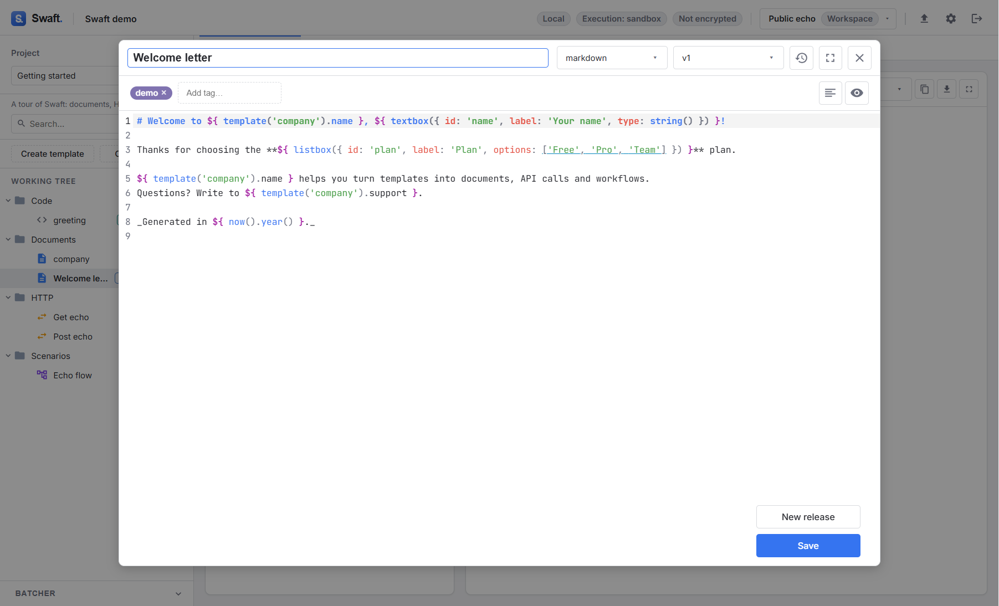

# The Working Tree
{: .no_toc }

  
Table of contents

  {: .text-delta }
1. TOC
{:toc}

---

The **Working Tree** is the left sidebar. It is how you organize and navigate everything in a
workspace. Resize it by dragging its right edge, hide it with **Collapse**, and bring it back with
**Open sidebar**.

## Projects

A **project** is a top-level container. Everything — folders and templates — lives inside a
project, and the tree shows only the **selected** project. Use projects to separate unrelated bodies
of work (for example one project per system, customer or integration).

The **Project** selector at the top of the tree lists your projects:

- pick one with **Select project**;
- add one with **Create project** (a **Name** and an optional **Description**, which is then shown
  under the selector);
- remove one with its delete button — its folders are deleted too, after confirmation.

## Folders

A **folder** groups templates inside a project. Folders can **nest**. Create one with **Create
folder** at the top of the tree, or **New subfolder** in a folder's menu.

For **API templates**, a folder is more than grouping — it acts as an **HTTP collection**. Opening a
folder shows its detail view with these tabs:

| Tab | Purpose |
|-----|---------|
| **Content** | The items in the folder. |
| **Headers** | Headers applied to every API request in the folder (subfolders included). A request's own header with the same name wins. |
| **Auth** | Authentication used by every request whose auth is set to **Inherit**. |
| **Actions** | Pre/post actions run around every request in the folder. Pre-actions run outermost-first, before the request's own; post-actions unwind innermost-first. |
| **Proxy** | A proxy (**Protocol**, **Hostname**, **Port**) for requests in the folder. Leave the hostname empty for a direct connection. |
| **Notes** | Free-form Markdown documentation. |

Header values and the proxy hostname may contain Seebo formulas. See
[API requests → Inheriting from folders](api-requests.md#inheriting-from-folders).

## Tags

A **tag** is a cross-cutting label. Unlike folders (where a template lives in exactly one place),
a template can carry **many tags**. Add tags in the template editor's tag bar (**Add tag…**) and
remove them from the same place. Use tags for themes that cut across folders — `draft`,
`smoke-test`, `customer-x`, and so on.

## Templates

A **template** is the authored unit. Create one with **Create template** at the top of the tree (or
**New template** in a folder's menu): pick its [type](../concepts.md#templates) and a **Name**.
Capability and action names are how formulas reference them, so use letters, digits and `_` (not
starting with a digit).

In the tree each template shows an icon for its type. Tools above the tree help you find things in a
large project:

| Tool | Effect |
|------|--------|
| **Search templates** | Matches template names **and content** (the draft and every release). |
| **Filter by type** | Show only one template type, or **All types**. |
| Badge toggle | Cycles what each row shows: a **subtype badge** (the HTTP method for API requests, the kind for code and scenarios, otherwise the document subtype) → **tags** (coloured dots) → nothing. |

You can also **drag files** from your operating system onto a folder (or the tree's empty area) to
import them as document templates — see
[Document templates](document-templates.md#importing-files-as-document-templates).

{: .tip }
> Templates can be **dragged** from the tree onto the [Batcher](batcher-and-releases.md#the-batcher)
> or a [scenario](scenarios.md) canvas — that's how you compose and wire them together.

## Context menus

Each template has a menu (the three-dot button on its row):

| Entry | Effect |
|-------|--------|
| **Edit** | Open the [template editor](#the-template-editor). |
| **Rename** | Rename the template. |
| **Export request…** | *(API templates)* Export this request — see [Import & export](#import--export). |
| **Export scenario as Arazzo…** | *(Scenarios)* Save the scenario as an Arazzo document. |
| **Import Arazzo…** | *(Scenarios)* Replace the scenario's graph from an Arazzo document. |
| **Delete** | Remove the template, after confirmation. |

A folder's menu offers **New subfolder**, **New template**, **Export folder…**, **Rename** and
**Delete**.

## Tabs

Opening a template or folder shows it in a **tab** to the right of the tree.

- **Single-click** an item to open it in a **preview tab** (shown in italics). There is at most one
  preview tab: the next item you single-click replaces it.
- **Double-click a tab** to pin it, so it stays open.
- **Double-click an item in the tree** to open the template editor (the default) or to pin its tab
  — choose under **Settings → Preferences → Working Tree double-click**.
- A **dot** on a tab marks unsaved changes. Closing such a tab asks you to confirm (**Close without
  saving**).

Open tabs stay loaded when you switch between them, so unsaved edits survive.

## The template editor

**Edit** (or a double-click in the tree, by default) opens the template editor over the workspace:

| Control | Purpose |
|---------|---------|
| **Template name** | Rename in place. |
| **Subtype** | Pick the subtype. Documents offer every [document subtype](document-templates.md#subtypes); other types have a single fixed subtype, shown as a badge. |
| **Release** picker | Switch between the **Draft** and each release, and delete one with its × button. |
| **Changelog** | Show the template's changelog. |
| **Toggle fullscreen** | Expand the editor to the full window. |
| Tag bar | **Add tag…** and remove tags. |
| **Format** | Reformat the source (formattable subtypes only — see [Document templates](document-templates.md#saving-inputs--formatting)). |
| **Show render** / **Show code** | *(HTML and Markdown documents)* Toggle between the source and an inline rendered preview. |
| **New release** | Save the current content as a named release. |
| **Save** | Save the selected version (the Draft, or the release you are viewing). |

The source editor highlights Seebo slots, offers autocompletion inside `${ … }`, and lists formula
problems with their diagnostic codes under the source. Press **Ctrl+F** (**Cmd+F** on macOS) to open
find & replace — see [Keyboard shortcuts](keyboard-shortcuts.md).

## Import & export

The **Import / Export** menu in the top bar, and the per-node entries above, move requests in and out
of Swaft using open formats:

| Entry | What it does |
|-------|--------------|
| **Import collection** | Import an **OpenAPI** description or a **Postman** collection (JSON or YAML, pasted or from a file) into a **new project**. |
| **Export project…** | Export the selected project's API requests. |
| **Export workspace…** | Export every API request in the workspace. |
| **Export folder…** / **Export request…** | Export one folder or one request (from the tree menus). |
| **Export scenario as Arazzo…** / **Import Arazzo…** | Round-trip a scenario as an [Arazzo](https://spec.openapis.org/arazzo/latest.html) document (from the scenario's menu). |
| **Export .swaft container…** | Package the whole workspace as a portable file — see [Workspaces](workspaces.md#exporting-and-opening-swaft-containers). |

Import creates each request as an `api` template, plus any collection-level variables as a new
**environment**.

Request exports support **Postman collection**, **.http file** and **Bruno collection**. Under
**Seebo formulas** you choose whether formulas are kept verbatim (**Keep verbatim (${ })**) or
translated to the target's own placeholder syntax (**Variabilize to {{ }}**, so `${ env('X') }`
becomes `{{X}}`). Only API requests are exported — documents, scenarios and code have no request
equivalent, so they are skipped and counted in the preview.

To copy or paste a single request as cURL, use the buttons in the [API view](api-requests.md#the-api-view).

### Bundling environments

The export dialog's **Environments to bundle** list lets you pick which environments to include,
defaulting to the active one. Each shows its [ownership badge](environments.md#personal-vs-workspace)
(**Personal** / **Workspace**) — think twice before including a personal one in an export you're
about to hand to someone else. A secret-labeled variable is never bundled; only its name appears, so
nothing is silently leaked into a file you share.

Postman gets a companion `*.postman_environment.json`; Bruno gets an `environments/*.bru` file inside
the collection. `.http` has no single-file environment concept, so a selection there isn't bundled.

A Bruno export also stamps each request with its Swaft template id (`meta.swaftId`), so tools that
understand the format can keep track of where a request came from.
