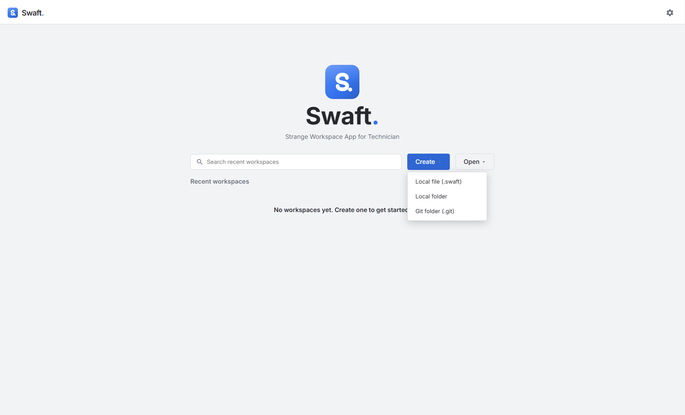

# Workspaces
{: .no_toc }

  
Table of contents

  {: .text-delta }
1. TOC
{:toc}

---

A **workspace** is everything you own in Swaft: projects, folders, tags, templates, releases,
environments and settings. You create or open it from the homepage and it opens into the workspace
shell.

## The homepage

| Control | What it does |
|---------|--------------|
| **Create** → **Local file (.swaft)** | Create a single-file workspace. |
| **Create** → **Local folder** | Create a folder workspace (plain files, no Git). |
| **Create** → **Git folder (.git)** | Create a workspace in a Git repository. |
| **Open** → **From .swaft** | Open a `.swaft` file — a single-file workspace or an exported container. |
| **Open** → **From folder** | Open a folder workspace or a Git workspace. |
| **Open** → **Clone from URL** | Clone a repository (**Repository URL**, **Destination folder**) and open it. |
| **Recent workspaces** | Reopen a workspace with one click. Encrypted ones carry an **Encrypted** badge. |
| **Search recent workspaces** | Filter the recent list by name or path. |
| **Remove from recent** | Drop an entry from the list. The workspace itself is not touched. |

The Git entries appear only when a `git` binary is found on your `PATH`.

## Storage forms

You choose the storage form when you create the workspace. **It cannot be changed later.** The
**Create workspace** dialog shows it under **Storage mode**, together with the **Workspace name**,
the **Location** (or **Folder**) and the **Execution mode**.

| Form | On disk | Encryption | Best for |
|------|---------|------------|----------|
| **Local file (.swaft)** | One `.swaft` file. | Optional, with a password. | A personal, self-contained workspace you can copy or back up as one file. |
| **Local folder** | A folder of plain, readable files. | No. | Inspecting or editing files with other tools, without Git. |
| **Git folder (.git)** | The same plain files in a Git repository. | No. | Teams, history, branches and reviewing changes as diffs. |

The folder and Git forms use the same documented file layout — see
[Workspace format](../reference/workspace-format.md). Folder and Git workspaces are **never
encrypted at rest by Swaft**; rely on file-system or repository access controls instead.

{: .note }
> Secrets (API tokens, passwords) are **never** written into any storage form. They live in your
> operating system's secure storage — see [Security & settings](security-and-settings.md#secrets).

## Encryption

A **Local file (.swaft)** workspace can be encrypted at creation: turn on **Encrypt this workspace**,
then enter and confirm a **Workspace password** (at least 8 characters). Swaft derives a key from
the password with **Argon2id** and encrypts the whole file with **AES-256-GCM**.

- You are prompted for the password (**Open encrypted workspace**) every time the workspace is
  opened.
- Encryption is independent of anything else — there is no separate app login.

{: .warning }
> **There is no recovery.** If you forget an encrypted workspace's password, the data is gone. Keep
> the password somewhere safe.

## Exporting and opening `.swaft` containers

Any open workspace — file, folder or Git — can be packaged as a portable **`.swaft` container**: a
standard zip of the [open folder format](../reference/workspace-format.md). Use it to move a
workspace to another machine, hand it to a colleague, or archive it.

- **Export:** open **Import / Export** in the top bar and choose **Export .swaft container…**, then
  pick where to save the file. The container is written unencrypted.
- **Open:** use **Open** → **From .swaft** on the homepage. Swaft unpacks the container into a
  sibling folder named after the file (for example `team.swaft` → `team/`) and opens that folder as a
  **Local folder** workspace. If that folder already exists from an earlier open, it is reused rather
  than overwritten. An encrypted container prompts for its password first.

**Open** → **From .swaft** also opens single-file workspaces directly, including files created by
earlier versions of Swaft.

{: .tip }
> Because a container is a regular zip, any unzip tool can read it. See
> [Workspace format → The `.swaft` container](../reference/workspace-format.md#6-the-swaft-container).

## The workspace shell

Once open, the workspace shows:

- **Working Tree** (left) — the **Project** selector, search, and your folders and templates. See
  [The Working Tree](working-tree.md). Drag the sidebar's right edge to **resize** it; use the
  **Collapse** button to hide it and **Open sidebar** to bring it back. When the Batcher is enabled,
  its panel sits under the tree.
- **Tabs** (right) — every template or folder you open gets a tab. See
  [Tabs](working-tree.md#tabs).
- **Top bar** — the workspace name and badges (execution mode, encryption), the Git status button
  (Git workspaces only), the [environment picker](environments.md), the **Import / Export** menu,
  **Settings** and **Close workspace**.

## Using Git version control

In a Git workspace, the **Git** status button in the top bar shows **Changes** or **Clean** and
opens the Git panel:

| Control | What it does |
|---------|--------------|
| **Branch** | Switch branches, or create one with **New branch…**. |
| **Changes** | The changed files. **View changes** opens a side-by-side diff of **Committed (HEAD)** against **Working tree**, with syntax highlighting. |
| **Commit message** + **Commit** | Commit all changes. |
| **Fetch** / **Pull** / **Push** | Sync with the remote (shown once the repository has a remote; the first push sets the upstream). |
| **Publish…** | Attach a **Remote URL** to a repository that has none, then publish. |
| **Reload** | Re-read the workspace from disk after changes made outside Swaft. |
| **Discard** | Discard **all** uncommitted changes (asks for confirmation; cannot be undone). |

Swaft shells out to the **`git` binary installed on your machine**, so it reuses your existing SSH
keys and credential helpers — there is nothing extra to configure.

If a pull leaves **merge conflicts**, Swaft tells you so; resolve them in your usual Git tool, then
click **Reload**.

### Pre-commit secret check

Before a **Commit** actually writes anything, Swaft scans the files it's about to write (API request
bodies, folder-propagated headers/auth, environment variables) for text that looks like a literal
secret — a bearer token, a well-known API key format, or a high-entropy string. A variable already
labeled **secret** (see [Environments](environments.md#config-vs-secret-label)) is skipped; it's an
acknowledged risk, not a surprise.

If something is found, the commit is refused and a **Possible secrets found** dialog shows exactly
what was flagged (a redacted hint, never the full value). Choose **Commit anyway** if it's a false
positive. Nothing is written to disk until you either fix it or confirm. The check runs only on
commit — saving a folder workspace is not gated the same way.

{: .tip }
> Because a Git workspace is just files, you can also edit history, resolve conflicts, or set up CI
> using your normal Git tooling outside Swaft. Click **Reload** to pick up external changes.

## Local-only data

Request and run history, action receipts, saved input values and your release and environment
selections are **local-only** — never committed and never shared. For a folder or Git workspace they
are kept in a small `.swaft/` cache directory next to your files (already `.gitignore`d, so it never
shows up as a change to commit), written on save and read back on open, so closing and reopening the
workspace keeps that history.

## Version compatibility

If a workspace was created by a **newer** version of Swaft, it refuses to open rather than risk
corrupting it — update the app.
